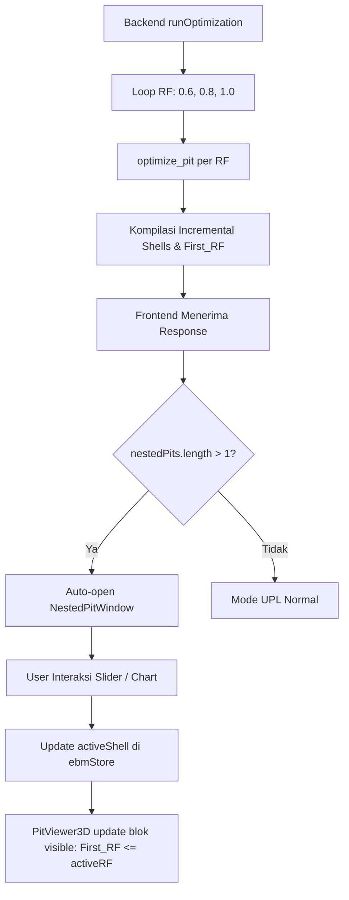

# DOKUMENTASI TEKNIS APLIKASI EBM ENGINE (ULTIMATE PIT LIMIT)
## Analisis Kode Sumber Lengkap & Panduan Developer
### Versi: **2.2.0-COMPACT-NPV** · Diperbarui: 14 Oktober 2026

> **Status validasi terukur:** `venv\Scripts\python.exe -m pytest tests -q -m "not slow"` menghasilkan 109 passed, 3 skipped, 2 deselected, dan 12 subtests passed. Selain itu, benchmark MineLib Marvin (`tests/test_minelib_marvin.py`) dijalankan langsung pada 14 Oktober 2026 dan lulus (UPV `1.415.655.436,14`, selisih `0,136539` terhadap 1.415.655.436,00, 8.516 blok tergali, 0 pelanggaran closure, waktu max-flow 0,70s).

---

## BAGIAN 1: TEKS KODE UTAMA

### 1.1 — `main.py` (Backend FastAPI — Entry Point)

```python
"""
================================================================================
  MAIN.PY - FastAPI Backend for EBM Engine Enterprise v2.2.0-COMPACT-NPV
================================================================================
  Endpoints:
    POST /api/v1/optimize-pit        -> Kalkulasi BEV, Graf Precedence (CompactGraph / NetworkX),
                                        Pit Limit Solver (scipy.sparse.csgraph.maximum_flow),
                                        Nested Pits RF, dan Analisis NPV Indikatif (pit_selection).
    POST /api/sensitivity            -> Analisis sensitivitas Undiscounted Pit Value 5 Skenario
    POST /api/v1/process-topography  -> Ekstraksi elevasi topografi dari CSV/TIF
================================================================================
"""

from fastapi import FastAPI, UploadFile, File, Form
from fastapi.middleware.cors import CORSMiddleware
import pandas as pd
import json

from core.compact_graph import DEFAULT_GRAPH_BACKEND
from core.economic_model import calculate_bev
from core.graph_builder import build_precedence_graph   # Router Dua-Gigi + CompactGraph Backend
from core.pit_optimizer import optimize_pit
from core.pit_selection import calculate_pit_selection  # Modul Evaluasi NPV Indikatif
from models.schemas import FinancialParameters

app = FastAPI(title="EBM Engine API", version="2.2.0-COMPACT-NPV")

@app.post("/api/v1/optimize-pit")
async def api_optimize_pit(
    file: UploadFile = File(...),
    financial_params: str = Form(...)
):
    params = FinancialParameters(**json.loads(financial_params))
    df = read_csv_robust(await file.read()).fillna(0)
    df = apply_column_aliases(df)

    # 1. Bangun Precedence Graph SATU KALI (Default backend: CompactGraph)
    graph = build_precedence_graph(
        df,
        osa=params.osa,
        geon_mapping=params.geon_mapping  # None -> Gigi 1 (Global OSA), dict -> Gigi 2 (GEON)
    )

    # 2. Nested Pit Iteration (Revenue Factors)
    raw_rfs = sorted(params.revenue_factors) if params.revenue_factors else [1.0]
    pit_selection_scenarios = {} if params.production_capacity_tpy is not None else None

    for rf in raw_rfs:
        current_params = params.model_copy()
        current_params.commodity_price = params.commodity_price * rf

        df_bev = calculate_bev(df, current_params)
        df_opt, optimizer_meta = optimize_pit(df_bev, graph, return_meta=True)

        if pit_selection_scenarios is not None:
            pit_selection_scenarios[float(rf)] = df_opt[["BEV", "Destination", "Tonase"]].copy()

    # 3. Evaluasi NPV Indikatif (Bila Kapasitas Produksi Diisi)
    pit_selection = None
    if params.production_capacity_tpy is not None and pit_selection_scenarios is not None:
        pit_selection = calculate_pit_selection(
            df_optimized,
            pit_selection_scenarios,
            production_capacity_tpy=params.production_capacity_tpy,
            discount_rate=params.discount_rate,
            mining_capacity_tpy=params.mining_capacity_tpy,
        )
```

**Semantik klasifikasi aktual:** `Model_Type` hanya membandingkan kadar mentah `Grade` dengan `cut_off_grade` dalam unit kadar yang dipilih: `Ore` jika `Grade >= cut_off_grade`, selain itu `Waste`. `Destination` dipilih terpisah dari cutoff: `Ore` jika `BEV_Ore >= BEV_Waste`, selain itu `Waste`; `BEV` adalah nilai terbesar di antara keduanya. Karena itu blok dengan `Model_Type=Waste` dapat memiliki `Destination=Ore` jika nilai ekonomi menggali dan memprosesnya sebagai ore lebih tinggi daripada nilai menggali sebagai waste. Contoh yang dikunci tes: `Grade=0.4`, cutoff `0.5`, `BEV_Ore=75`, `BEV_Waste=-25` menghasilkan `Model_Type=Waste`, `Destination=Ore`, `BEV=75`.

Backend menghitung tonase ore/waste ringkasan memakai `Destination`. Frontend memakai `Destination` untuk warna mode Destination dan label tujuan blok; grade heatmap mengabu-abukan blok jika Grade di bawah cutoff atau salah satu label menunjukkan Waste. Hitungan ore pada Inspector memakai kondisi `Destination=Ore OR Model_Type=Ore`, sehingga definisi hitungan UI itu tidak selalu sama dengan ringkasan backend pada kasus label yang berkonflik.

---

### 1.2 — `economic_model.py` (Kalkulasi BEV & Dynamic Cost Matrix)

```python
import pandas as pd
import numpy as np
from models.schemas import FinancialParameters

def calculate_bev(df: pd.DataFrame, params: FinancialParameters) -> pd.DataFrame:
    """
    Fase 1: Kalkulasi Nilai Ekonomi Blok (Block Economic Value / BEV)
    """
    df = df.copy()
    
    # Kalkulasi Volume & Tonase
    if 'Volume' not in df.columns:
        df['Volume'] = df['DX'] * df['DY'] * df['DZ']
    if 'Tonase' not in df.columns:
        df['Tonase'] = df['Volume'] * df['Density']
        
    # --- BEV ORE ---
    revenue = df['Tonase'] * df['Grade'] * params.metallurgical_recovery * params.commodity_price
    
    # Dynamic Cost Matrix (Biaya penambangan bergantung pada kepadatan batuan)
    density_factor = df['Density'] / 2.5
    effective_ore_mining_cost = params.ore_mining_cost * density_factor
    
    cost_ore = df['Tonase'] * (effective_ore_mining_cost + params.processing_cost + params.selling_cost)
    bev_ore = revenue - cost_ore
    
    # --- BEV WASTE ---
    effective_waste_mining_cost = params.waste_mining_cost * density_factor
    bev_waste = -1.0 * df['Tonase'] * effective_waste_mining_cost
    
    # Keputusan (Vectorized NumPy)
    df['BEV'] = np.maximum(bev_ore.values, bev_waste.values)
    df['Destination'] = np.where(bev_ore.values >= bev_waste.values, 'Ore', 'Waste')
    df['Model_Type']  = np.where(df['Grade'].values >= params.cut_off_grade, 'Ore', 'Waste')

    return df
```

---

### 1.3 — JavaScript Frontend (`ebmStore.ts` — Call API & State)

```typescript
  // State GEON (ditambahkan v2.0.1-GEON)
  geonEnabled: false,
  geonMapping: {} as Record<string, number>,
  setGeonEnabled: (enabled) => set({ geonEnabled: enabled, isStale: true }),
  setGeonMapping: (mapping) => set({ geonMapping: mapping, isStale: true }),

  runOptimization: async () => {
    const { financialParams, csvFile, geonEnabled, geonMapping, lithologyColors } = get();
    if (!csvFile) { set({ error: 'Upload CSV terlebih dahulu.' }); return; }
    set({ isLoading: true, error: null });

    try {
      // Bangun payload — sertakan geon_mapping HANYA jika GEON aktif
      const payload = {
        ...financialParams,
        ...(geonEnabled && Object.keys(geonMapping).length > 0
          ? { geon_mapping: geonMapping }   // → backend Gigi 2
          : { geon_mapping: null }),         // → backend Gigi 1 (fallback)
      };

      const formData = new FormData();
      formData.append('file', csvFile);
      formData.append('financial_params', JSON.stringify(payload));

      const res = await fetch('http://127.0.0.1:8001/api/v1/optimize-pit', {
        method: 'POST',
        body: formData,
      });
      if (!res.ok) {
        const err = await res.json().catch(() => ({}));
        throw new Error(err.detail || `Server error ${res.status}`);
      }

      // ⚠️ PENTING: Gunakan res.text() + JSON.parse(), BUKAN res.json().
      // Pada dataset besar (>28k blok), res.json() bawaan browser menggunakan parser
      // rekursif internal yang dapat menyebabkan "RangeError: Maximum call stack size
      // exceeded". Pendekatan text()+JSON.parse() menghasilkan objek identik namun
      // lebih toleran terhadap respons JSON berukuran besar.
      const rawText = await res.text();
      const data = JSON.parse(rawText);

      const blocks: BlockData[] = data.pit_shell_matrix || [];

      // Hitung batas koordinat dengan satu for-loop pass.
      // Menghindari spread operator Math.min(...arr) dan .reduce() yang juga rentan
      // terhadap call stack overflow pada array berukuran puluhan ribu elemen.
      let minX = 0, maxX = 100, minY = 0, maxY = 100, minZ = 0, maxZ = 100;
      if (blocks.length > 0) {
        let x0 = blocks[0].Local_X, x1 = x0;
        let y0 = blocks[0].Local_Y, y1 = y0;
        let z0 = blocks[0].Z,       z1 = z0;
        for (let i = 1; i < blocks.length; i++) {
          const b = blocks[i];
          if (b.Local_X < x0) x0 = b.Local_X; else if (b.Local_X > x1) x1 = b.Local_X;
          if (b.Local_Y < y0) y0 = b.Local_Y; else if (b.Local_Y > y1) y1 = b.Local_Y;
          if (b.Z       < z0) z0 = b.Z;       else if (b.Z       > z1) z1 = b.Z;
        }
        minX = x0; maxX = x1;
        minY = y0; maxY = y1;
        minZ = z0; maxZ = z1;
      }

      set({
        summary: data.summary,
        pitBlocks: blocks,
        nestedPits: data.nested_pits || [],
        incrementalShells: data.incremental_shells || [],
        pitSelection: data.pit_selection ?? null,
        minX, maxX, minY, maxY, minZ, maxZ,
        clippingX: maxX + 10, clippingY: maxY + 10, clippingZ: maxZ + 10,
        isLoading: false,
        isStale: false,
      });
    } catch (error: any) {
      set({ error: error.message, isLoading: false });
    }
  }
```

> **Catatan Ketahanan (`runOptimization`):** Dua praktik penting yang harus dijaga pada fungsi ini:
> 1. **`res.text()` + `JSON.parse()`** — Wajib dipertahankan. Jangan diganti kembali ke `res.json()`. Pada payload >28k blok, `res.json()` browser menggunakan parser rekursif internal yang menyebabkan `RangeError: Maximum call stack size exceeded`. Hasil parsing **identik matematis**, tidak ada perbedaan nilai.
> 2. **For-loop tunggal untuk batas koordinat** — Wajib dipertahankan. `Math.min(...arr)` dan `.reduce()` pada array besar juga rentan terhadap overflow yang sama. For-loop O(N) dengan satu pass adalah satu-satunya cara yang aman dan efisien untuk dataset skala besar.

---

## BAGIAN 2: ALUR DATA (DATA PIPELINE)

### Diagram Arsitektur Sistem

```mermaid
flowchart TD
    subgraph FRONTEND ["💻 FRONTEND (React / Next.js)"]
        A["📄 Project Explorer\nUpload CSV & Input Financial"]
        B["⚙️ Zustand Store\nGlobal State Management"]
        C["🚀 fetch() POST\nKirim Multipart FormData"]
        D["📊 Inspector Panel\nUI Executive Summary"]
        E["🧊 React Three Fiber\nInstancedMesh 3D Render"]
    end

    subgraph BACKEND ["⚙️ BACKEND (FastAPI / Python)"]
        F["📡 POST /api/v1/optimize-pit\nValidasi Pydantic"]
        G["🧮 economic_model.py\nKalkulasi BEV (NumPy)"]
        H["🕸️ graph_builder.py\nSciPy KDTree Spasial"]
        I["⛏️ pit_optimizer.py\nMax-Flow CSR Matrix"]
        J["📦 JSON Response\nKirim hasil MINED_STATUS"]
    end

    A -->|User Action| B
    B -->|Trigger runOptimization()| C
    C -->|Upload File & JSON| F
    F --> G
    G --> H
    H --> I
    I --> J
    J -->|Kembalikan Data| B
    B -->|Update State| D
    B -->|Update State| E
```

---

### 2.1 — Langkah-langkah Detail: Dari File Mentah ke Grafis 3D

#### STEP 1: Ingestion (User Upload & Setting)
- User memilih file CSV Block Model melalui frontend; ukuran maksimum file tidak diukur dalam panduan ini.
- User mengatur *Financial Parameters* (Harga Komoditas, Biaya, dll). Parameter ini disimpan secara asinkron di **Zustand Store**.

#### STEP 2: Transfer Data ke Backend
- Saat fungsi `runOptimization()` dipanggil, data CSV beserta *Financial Parameters* disatukan ke dalam `FormData` dan dikirim via `POST` ke *endpoint* FastAPI (`http://localhost:8001/api/v1/optimize-pit`).

#### STEP 3: Valuasi Ekonomi (Phase 1)
- `economic_model.py` membaca CSV mentah menggunakan pustaka `Pandas`.
- Algoritma melakukan pengecekan **Dynamic Cost Matrix**, di mana biaya penambangan (*mining cost*) diskalakan terhadap `Density` batuan. Blok batuan yang berat akan memakan biaya penambangan yang lebih tinggi.
- Nilai profitabilitas setiap kubus dikalkulasi menjadi `BEV` (Block Economic Value).

#### STEP 4: Koneksi Ketergantungan Spasial (Phase 2)
- `graph_builder.py` memakai offset untuk grid reguler dan full KDTree untuk Global OSA pada grid non-reguler. GEON hanya menerima grid reguler dan mapping semua RockType.
- Edge `u -> v` berarti menggali blok `u` mensyaratkan blok `v` di atasnya ikut digali.

#### STEP 5: Pencarian Pit Maksimum (Phase 3)
- Graf precedence diumpankan ke `pit_optimizer.py`; optimizer menyusun kapasitas int32 dan memanggil `scipy.sparse.csgraph.maximum_flow`.
- Tidak ada klaim perbandingan kecepatan di sini; algoritma Pseudoflow tidak diimplementasikan.

#### STEP 6: Render Visualisasi 3D GPU
- Frontend menerima array JSON hasil perhitungan dan memetakannya ke `PitViewer3D.tsx`.
- Komponen menggunakan `THREE.InstancedMesh`; batas jumlah blok dan FPS maksimum tidak diukur pada validasi ini.

---

### 2.2 — Diagram Sequence (Alur Waktu)

```mermaid
sequenceDiagram
    actor User
    participant UI as 💻 Frontend (React)
    participant API as ⚙️ FastAPI Backend
    participant BEV as 🧮 Economic Model
    participant Graph as 🕸️ Precedence Graph (CompactGraph / NetworkX)
    participant Opt as ⛏️ Max-Flow/Min-Cut (scipy.sparse.csgraph.maximum_flow)
    participant PitSel as 📊 Pit Selection & NPV
    participant 3D as 🧊 WebGL Canvas

    User->>UI: Upload CSV & Set Parameter
    User->>UI: Klik "Run Optimization"
    
    UI->>API: POST /api/v1/optimize-pit (FormData)
    
    API->>BEV: calculate_bev(df, params)
    BEV-->>API: DataFrame dengan BEV_Ore & BEV_Waste
    
    API->>Graph: build_precedence_graph(df, OSA / GEON)
    Graph-->>API: Graf Ketergantungan (CompactGraph int32)
    
    loop Nested Pits (Revenue Factors)
        API->>BEV: calculate_bev(df, params * RF)
        API->>Opt: optimize_pit(df_bev, Graph)
        Opt->>Opt: Konversi ke SciPy CSR Matrix (Zero-Copy)
        Opt->>Opt: Hitung Maximum Flow
        Opt-->>API: DataFrame dengan MINED_STATUS (1 atau 0)
    end

    opt Bila production_capacity_tpy > 0
        API->>PitSel: calculate_pit_selection(df, nested_pits, ...)
        PitSel-->>API: Ranking NPV Indikatif (Best vs Worst)
    end
    
    API-->>UI: JSON Response {summary, blocks, nested_pits, pit_selection}
    
    UI->>3D: Perbarui InstancedMesh Matrix
    UI->>User: Tampilkan Panel Eksekutif, Laporan Tab, & Visual 3D
```

---

### 2.3 — Algoritma Spasial (Offset Pattern + Transitive Reduction)

Pencarian hierarki tambang (memastikan blok atas digali sebelum blok bawah) memakan waktu $O(N^2)$ jika dievaluasi dengan *nested loop* polos. EBM Engine saat ini mengimplementasikan **pola offset kerucut + transitive reduction** pada grid reguler, yang secara dramatis mengurangi jumlah edge yang diperlukan.

**Arsitektur builder baru (`build_precedence_graph`):**
1. **Deteksi grid reguler**: Cek apakah spasi X/Y/Z konstan. Jika tidak reguler → fallback ke `build_precedence_graph_full` (KDTree).
2. **Pola offset kerucut penuh**: Untuk setiap `dk` level di atas, hitung semua offset `(di, dj)` yang masuk radius `dk × dz / tan(OSA) + 1e-9`.
3. **Transitive Reduction**: Buang offset `o` jika dapat dihasilkan dari dua offset lain `o1 + o2` (keduanya ada dalam pola). Pengurangan edge signifikan:
   - OSA 30°: 2681 offset → 117 (reduksi 95%)
   - OSA 45°: 889 offset → 25 (reduksi 97%)
   - OSA 60°: 305 offset → 33 (reduksi 89%)
4. **Pembentukan edge vektor**: Gunakan array *slicing* pada grid 3D (tanpa KDTree, tanpa loop per blok). Guard `MAX_EDGES = 50.000.000` tetap aktif.

**Strategi grid tidak penuh (topografi):** Builder mendeteksi blok yang ada (`grid cell != -1`) dan hanya membuat edge antar blok nyata. Blok udara (sel kosong) tidak memerlukan node dummy karena transitivitas sudah tidak diperlukan—pola offset mencakup semua level langsung.

```text
%=========================================================================%
%              POLA OFFSET KERUCUT + TRANSITIVE REDUCTION                 %
%=========================================================================%
%  Full offsets (OSA 45): 889 → Reduced: 25 (hanya level pertama!)     %
%                                                                         %
%  Blok A (Z=0) terhubung ke pola kecil,                                %
%  transitivitas NetworkX melengkapi closure ke atas.                    %
%                                                                         %
%  Kompleksitas: O(|reduced_offsets| × N) bukan O(N × cone_size)       %
%  Rasio edge baru/penuh: 5%–40% tergantung OSA dan grid                %
%=========================================================================%
```

---

### 2.4 — Ringkasan File Artefak

| File | Tipe | Dibuat Oleh | Fungsi Utama |
|---|---|---|---|
| `main.py` | Backend | EBM Architect | Server utama FastAPI, mengatur rute API (Optimize, Topo, Sensitivity, Pit Selection). |
| `compact_graph.py` | Backend | EBM Architect | Modul representasi graf memori rendah (array NumPy int32 kontigu, 8 byte/edge) dengan interop NetworkX. |
| `economic_model.py` | Backend | EBM Architect | Memanipulasi vektor DataFrame Pandas untuk mengalkulasi nilai BEV. |
| `graph_builder.py` | Backend | EBM Architect | Logika keruangan trigonometri, offset pattern, transitive reduction, router Global OSA & GEON. |
| `pit_optimizer.py` | Backend | EBM Architect | Algoritma optimasi tambang tingkat tinggi (CSR Sparse Matrix & Max-Flow SciPy) dengan jalur cepat CompactGraph. |
| `pit_selection.py` | Backend | EBM Architect | Evaluasi ranking NPV indikatif (DCF best-case vs worst-case) berbasis Revenue Factor nested pits. |
| `ebmStore.ts` | Frontend | EBM Architect | *Central nervous system* bagi UI. Menyimpan CSV, API Calls, dan State Panel. |
| `PitViewer3D.tsx` | Frontend | EBM Architect | Mesin *rendering* WebGL 3D. Menangani *Color Mapping*, Studio Lighting, Theme Dark/White, dan Slicer. |
| `exportPDF.ts` | Frontend | EBM Architect | Generator PDF yang menangkap *screenshot* kanvas 3D secara rahasia. |
| `SensitivityWindow.tsx` | Frontend | EBM Architect | Modul visual yang melambungkan *Chart.js* dari respons 5 iterasi Harga Komoditas. |

---

### 2.5 — Fitur Tambahan & "Hidden Gems" 💎

1. **Parameter Decoupling & EBM Workspace**
   Sistem operasi penyimpanan (Save Workspace). File `.ebm` hanyalah *blueprint* ringan dari parameter finansial dan visibilitas layer (JSON), sehingga tidak memberatkan *storage* user dengan duplikasi data CSV.

2. **preserveDrawingBuffer: true**
   Fitur rahasia WebGL. Tanpa bendera (flag) ini, pengambilan *screenshot* PDF grafis 3D akan gagal karena *buffer frame* dibersihkan setiap kali GPU berkedip. Atribut ini mengizinkan PDF Engine memotret mahakarya 3D dengan resolusi tajam.

3. **Dynamic Debouncing Input**
  Event perubahan parameter memakai debounce 500ms pada UI. Throughput request dan dampak latensinya tidak diukur pada validasi ini.

4. **Multi-Mode Heatmap Instancing**
  `PitViewer3D.tsx` mengatur warna instance untuk mode Destination, Grade Heatmap, Economic (BEV), Lithology, dan Pushback Phase. Throughput perubahan warna tidak diukur.

---

## BAGIAN 3: VALIDASI ALGORITMA — MINELIB NEWMAN1

### 3.1 — Tujuan & Metodologi

Sebelum inti optimizer (`pit_optimizer.py`) dipakai secara luas, algoritma utamanya (max-flow/min-cut) divalidasi pada **dataset benchmark publik MineLib "newman1"** yang memiliki solusi optimal yang telah diverifikasi secara independen.

**Referensi resmi MineLib**: `UPV optimal = 26,086,899` (sumber: [mansci-web.uai.cl/minelib](http://mansci-web.uai.cl/minelib), diakses pada 4 Oktober 2026)

### 3.2 — File yang Dibuat

| File | Deskripsi |
|------|-----------|
| `ebm-api-engine/utils/minelib_parser.py` | Parser untuk `newman1.blocks` dan `newman1.prec`. Fungsi: `parse_blocks()`, `block_values()`, `parse_precedence()` |
| `ebm-api-engine/tests/test_minelib_validation.py` | Test validasi lengkap. Dapat dijalankan via `pytest` atau `python` langsung |
| `ebm-api-engine/newman1_data/newman1.blocks` | Dataset blok MineLib newman1 (1060 blok) |
| `ebm-api-engine/newman1_data/newman1.prec` | Graf precedence MineLib newman1 (3922 sisi) |

### 3.3 — Ringkasan `pit_optimizer.py`

- **Fungsi utama**: `optimize_pit(df, G, return_meta=False)`
- **Input**: DataFrame wajib punya kolom `BEV`; `G` = NetworkX DiGraph dengan edge precedence (`u → v` berarti "untuk gali `u`, harus gali `v` dulu"); `return_meta` (bool, default `False`)
- **Output**: DataFrame + kolom `MINED_STATUS` (1=digali, 0=tidak). Jika `return_meta=True`, fungsi mengembalikan tuple `(df, meta)` di mana `meta` berisi `autoscale_triggered`, `effective_divisor`, `effective_scale`, `max_rounding_error_per_block`, `pos_sum_before_scale`, `pos_sum_after_scale`, dan `n_clipped`.
- **Mekanisme**: Max-weight closure via SciPy `maximum_flow` pada CSR matrix. BEV>0 → `source→blok`, BEV<0 → `blok→sink`, edge precedence → kapasitas INF. Blok reachable dari source di residual graph = himpunan MINED.
- **Proteksi overflow**: Auto-scale jika total BEV positif > 1e9; clip ke `[-2e9, 2e9]` sebelum cast ke `int32`.
- **Batas resolusi numerik**: Dengan `effective_scale = s`, galat pembulatan maksimum per blok adalah `0.5 / s`, dan langkah kapasitas BEV adalah `1 / s`. Nilai positif/negatif yang magnitudonya di bawah langkah tersebut dapat membulat menjadi kapasitas nol dan mengubah himpunan pit atau nilai objektif; optimizer tidak menjamin optimum terhadap BEV float asli untuk nilai di bawah resolusi kapasitas.
- **Kontrak ID graf**: node ID adalah posisi baris DataFrame `[0, len(df))`, bukan label `df.index`. Builder tidak reset atau mengurutkan DataFrame. Optimizer menolak graph node/edge ID di luar rentang dengan `ValueError`.
- **Metadata API aditif**: `graph_info` berisi `mode`, `backend`, `fallback_used`, `reason`. `optimizer_meta` berisi metadata skala/pembulatan/clipping untuk tiap RF, dengan `rf` sebagai field tambahan.

### 3.4 — Fakta Data newman1

- **newman1.blocks**: 1060 baris, 11 kolom, TANPA header:
  `id x y z type grade tonns min_caf value_extracc value_proc apriori_process`
  - Kolom `type` = string kode (FRWS, FROR, OXOR, ...)
  - **Nilai blok UPL = `max(value_extracc, value_proc)`** — pilih destinasi terbaik
  - Blok non-processable punya `value_proc ≈ -5e19`; **wajib di-clip ke [-1e15, 1e15] sebelum skala**
- **newman1.prec**: 1060 baris, format `"block_id n_prec pred_1 pred_2 ..."`, total 3922 sisi
  - Arah sisi: `block_id → predecessor_id` (kapasitas INF) — artinya gali blok butuh semua pendahulunya digali dulu

### 3.5 — Hasil Validasi MineLib pada 12 Oktober 2026

Perintah langsung dari `ebm-api-engine`: `venv\Scripts\python.exe tests\test_minelib_validation.py`.

- 3/3 assertion lulus: closure, kesamaan objective SciPy/NetworkX, dan toleransi referensi.
- 1.059/1.060 blok; UPV aktual `26,086,899.025970`; delta terhadap nilai referensi bulat `0.025970`; SciPy vs NetworkX delta `0.000000`.
- Exit code skrip langsung: 0 setelah perbaikan harness.
- Matriks sensitivitas empat skala yang tercetak berasal dari `test_minelib_validation.py`; skala 1, 10, 100, dan 1000 semuanya auto-scale pada source yang dijalankan. Angka divisor per skala tidak dikutip di sini agar tidak mencampur keluaran run sebelumnya dengan source saat ini.

Status Marvin: tes `tests/test_minelib_marvin.py` memakai `pit_optimizer.py`, tetapi ditandai slow dan tidak dijalankan pada validasi ini. Hasil historis Marvin bukan hasil run 12 Oktober 2026.

### 3.6 — Cara Menjalankan Ulang

```powershell
# Dari direktori ebm-api-engine:
$env:PYTHONIOENCODING="utf-8"
.\venv\Scripts\python.exe tests\test_minelib_validation.py

# Atau via pytest:
.\venv\Scripts\python.exe -m pytest tests\test_minelib_validation.py -v -s
```

### 3.7 — Kesimpulan & Status Validasi MineLib

> **Status validasi MineLib:** newman1 dijalankan lewat `pit_optimizer.py` dan 3/3 assertion lulus pada validasi 12 Oktober 2026. Marvin: label target validasi `pit_optimizer.py` dipertahankan, tetapi tes Marvin tidak dijalankan pada run ini.

### 3.8 — Cakupan dan Batasan Validasi

Pengujian ini memiliki batasan ruang lingkup (*scope*) sebagai berikut:
1. Perintah final `venv\Scripts\python.exe -m pytest tests -q -m "not slow"` menghasilkan **67 passed, 3 skipped, 2 deselected, 12 subtests passed**. Skipped merupakan tes yang tidak mempunyai dataset eksternal; deselected mencakup benchmark slow yang tidak dijalankan.
2. Tes baru yang disertakan: `test_graph_node_index_integrity.py`, `test_geon_contract.py`, `test_precision_metadata.py`, dan `test_economic_classification_semantics.py`.
3. **Dataset eksternal (MineLib)**: newman1 dijalankan lewat EBM (UPV `26,086,899.025970` vs referensi bulat `26,086,899`). Marvin melalui `pit_optimizer.py` belum dijalankan dalam run ini.
4. **Keterbatasan SciPy int32**: `scipy.sparse.csgraph.maximum_flow` menggunakan kapasitas `int32`. Optimizer membulatkan dan melakukan clipping setelah penskalaan; nilai di bawah resolusi `1 / effective_scale` dapat menjadi nol. Meta melaporkan `effective_scale`, `max_rounding_error_per_block`, dan `n_clipped`.
5. **Pekerjaan lanjutan yang direncanakan**:
   - Menjalankan `pit_optimizer.py` secara langsung pada dataset Marvin dan dataset MineLib lainnya.
   - Evaluasi solver alternatif berkapasitas `float64` atau `int64` jika dibutuhkan di masa depan (Catatan: algoritma Pseudoflow belum diimplementasikan; implementasi saat ini menggunakan Max-Flow/Min-Cut `scipy.sparse.csgraph.maximum_flow`).

### 3.9 — Validasi & Peningkatan `graph_builder.py`

> **Catatan pengukuran:** tabel waktu, rasio edge, dan benchmark 100k pada bagian ini adalah hasil historis dari lingkungan lain; tidak diukur ulang pada 12 Oktober 2026. Jangan gunakan sebagai klaim performa terkini.

#### Riwayat Bug Lama
Implementasi awal membuat edge hanya ke **satu level Z** di atasnya, mengandalkan transitivitas NetworkX untuk menutup kerucut ke atas. Ini CACAT FATAL: menghasilkan pit berbentuk belah ketupat dan *under-excavation* parah.

#### Perbaikan Sebelumnya (versi cKDTree full)
Setiap blok dihubungkan ke **semua level Z di atasnya** lewat KDTree 2D per-level. Metode ini membentuk relasi cone penuh, tetapi throughput dan batas skala untuk model besar tidak diukur pada validasi ini.

#### Implementasi Terkini (Offset Pattern + Transitive Reduction)
Builder baru mendeteksi grid reguler lalu:
1. Menghitung **pola offset** kerucut dari origin ke semua level Z di atas.
2. Melakukan **transitive reduction** pada pola: buang offset yang bisa dicapai via dua offset lain. Cukup sekali per (OSA, grid spacing), bukan per blok.
3. Membentuk edge via **array slicing** (tanpa loop per blok).

**Reduksi Offset per OSA (grid kubik 10 m, 10 level Z):**

| OSA | Offset Penuh | Offset Tereduksi | Reduksi |
|-----|-------------|-----------------|--------|
| 30° | 2681 | 117 | 95.6% |
| 35° | 1833 | 57 | 96.9% |
| 45° | 889 | 25 | 97.2% |
| 50° | 637 | 77 | 87.9% |
| 60° | 305 | 33 | 89.2% |

**Rasio Edge Baru vs Full (Tes A2 — Closure Identik, Selisih 0):**

| Grid | OSA | Edge Baru | Edge Full | Rasio | Waktu Baru | Waktu Full |
|------|-----|-----------|-----------|-------|-----------|----------|
| 12×12×8, dz=10 | 30° | 27,428 | 229,480 | 12.0% | 0.08s | 1.67s |
| 20×20×10, dz=10 | 30° | 150,944 | 1,898,840 | 7.9% | 1.12s | 11.52s |
| 12×12×8, dz=10 | 45° | 8,432 | 107,980 | 7.8% | 0.04s | 0.36s |
| 20×20×10, dz=10 | 45° | 38,768 | 797,512 | 4.9% | 0.24s | 10.72s |
| 20×20×10, dz=10 | 60° | 54,884 | 305,428 | 18.0% | 0.12s | 3.60s |
| 12×12×8, dz=5 | 30° | 26,860 | 82,828 | 32.4% | 0.16s | 0.48s |
| 20×20×10, dz=5 | 45° | 28,172 | 243,572 | 11.6% | 0.18s | 1.03s |

**Strategi Grid Tidak Penuh (Tes G — Topografi Bergelombang Kuat):**
Sel kosong di bounding box (blok udara dihilangkan karena topografi bergelombang) **tidak memerlukan node dummy**. Builder offset hanya membuat edge antar blok yang benar-benar ada (`grid cell != -1`). Transitivitas tetap sah karena ketergantungan lereng antar blok batuan nyata terhubung secara konsisten. Tes G membuktikan closure 100% identik dengan referensi full untuk **seluruh blok nyata** pada topografi relief kuat (lereng bukit + gelombang sinusoidal).

**Hasil Pengujian (Pit Eksak, 1 Blok Target di Dasar — Tes B):**

| OSA Target | Blok Digali (Referensi Analitik) | Blok Digali (Builder Full) | Blok Digali (Offset Baru) | Status |
| --- | --- | --- | --- | --- |
| 30° | 494 blok | 494 blok | 494 blok | **LULUS** ✓ |
| 35° | 358 blok | 358 blok | 358 blok | **LULUS** ✓ |
| 45° | 178 blok | 178 blok | 178 blok | **LULUS** ✓ |
| 50° | 126 blok | 126 blok | 126 blok | **LULUS** ✓ |
| 60° | 62 blok | 62 blok | 62 blok | **LULUS** ✓ |

> **Catatan Validasi OSA 50°**: Angka lama 122 terbukti merupakan referensi manual basi. Evaluasi fungsi analitik independen `expected_blocks(50, 10, 10, 5, 7)` menghasilkan tepat **126 blok**, yang mana identik dengan hasil `build_precedence_graph_full` (126 blok) dan `build_precedence_graph` baru (126 blok). Nilai pengujian Tes B telah diperbarui menggunakan kalkulasi fungsi analitik dinamis.

Tes A, A2, B, C, E, G dan H di bawah ini termasuk dalam suite non-slow yang dijalankan pada 12 Oktober 2026. Angka benchmark performa terpisah yang pernah dicantumkan sesudahnya tidak diukur ulang.

| Tes | Deskripsi | Status |
| --- | --- | --- |
| **A (Full)** | Edge KDTree full identik referensi geometris | **LULUS** 5/5 OSA |
| **A2** | Closure offset baru = closure full (grid kecil + non-kubik) | **LULUS** 20/20 kombinasi |
| **B** | Pit eksak dari 1 blok berharga (konsisten rumus analitik) | **LULUS** 5/5 OSA |
| **C** | Sudut lereng geometris valid | **LULUS** |
| **E** | Non-kubik dz=5 | **LULUS** |
| **G** | Topografi bergelombang kuat (seluruh blok closure identik) | **LULUS** |
| **H (Optimizer)** | Pemeriksaan skala kapasitas optimizer | **LULUS** |
| **MineLib** | 3/3 assertion newman1 | **LULUS** |
| **F (Performa)** | Benchmark 100k blok; slow/deselected dan tidak diukur pada run ini | **TIDAK DIJALANKAN** |

**Hasil historis benchmark builder (100.000 blok - Grid 50x50x40; tidak diukur ulang):**

| OSA | Waktu (s) | Total Edge | Edge/Blok | Reduksi Offset |
|-----|-----------|------------|-----------|----------------|
| 30° | 155.33 s | 13.377.452 | 133.8 | 193.611 → 533 |
| 45° | 59.35 s | 3.206.756 | 32.1 | 64.311 → 93 |
| 60° | 47.34 s | 6.317.524 | 63.2 | 21.519 → 153 |

*Catatan: Jumlah edge dan durasi di tabel tersebut merupakan hasil historis yang tidak diukur ulang; penggunaan RAM dan keamanan model 100.000 blok tidak diukur pada validasi ini.*

#### Keterbatasan SciPy int32 (Tes H)

SciPy `maximum_flow` bekerja dengan kapasitas `int32` (maks ±2,147,483,647). Untuk model blok dengan nilai BEV besar:
- `pit_optimizer.py` kini secara otomatis men-*scale* nilai sebelum masuk ke solver: skala default `1000×`, diturunkan jika `pos_sum × 1000 > 1.5 miliar`.
- Post-check saturasi: jika ada edge precedence terisi penuh (`flow ≥ INF_CAP`), dilempar `ValueError` karena hasilnya tidak valid.
- **Catatan solver**: Algoritma Pseudoflow belum diimplementasikan; implementasi saat ini murni menggunakan Max-Flow/Min-Cut (`scipy.sparse.csgraph.maximum_flow`). Untuk model sangat besar (>500k blok, nilai ekstrem), solver Pseudoflow sejati (misalnya `python-pseudoflow`) yang mendukung `float64` dapat dipertimbangkan di masa mendatang.

### 3.10 — Standardisasi Satuan & Preset Komoditas

EBM Engine mendukung normalisasi satuan kadar dan harga secara fleksibel tanpa mengubah struktur graf/optimizer:
- **FinancialParameters**: Lapangan baru `grade_unit` (`g_per_t`, `percent`, `fraction`, `ppm`), `price_unit` (`per_gram`, `per_kg`, `per_t_metal`, `per_troy_oz`), dan `currency` (misal: `IDR`, `USD`). Default: `g_per_t`, `per_gram`, `IDR` (identik backward-compatible).
- **Rumus Revenue**: `grade_fraction = Grade / GRADE_DIVISOR[grade_unit]` dan `price_per_t_metal = commodity_price * PRICE_FACTOR[price_unit]`. Revenue dihitung sebagai `Tonase * grade_fraction * recovery * price_per_t_metal`.
- **Cut-off Grade**: Dibandingkan langsung dengan kolom `Grade` CSV (tidak dikonversi).
- **UI & Reporting**: Preset komoditas (Emas, Nikel laterit, Tembaga) di `WorkspaceModal` dengan placeholder harga demo; label dinamis di `ProjectExplorer`, `InspectorPanel` (rename: "Total Undiscounted Pit Value"), dan `exportPDF`.
- **Catatan Satuan (BEV Meledak)**: Jika BEV tampak meledak miliaran rupiah untuk blok berkadar rendah, penyebab paling umum adalah **kombinasi `grade_unit` yang salah dipilih di UI**. Kode sudah benar (divisor 1.0/100/1e6/1e6 per unit). Lihat tabel di bawah.

| Grade CSV | Makna | `grade_unit` yang benar |
|-----------|-------|------------------------|
| `1.5` (g/t) | 1,5 gram per ton | `g_per_t` (default) |
| `1.5` (%) | 1,5 persen | `percent` |
| `0.015` (fraksi) | 1,5% | `fraction` |
| `1500` (ppm) | 1.500 ppm | `ppm` |

### 3.11 — Validasi Independen

Untuk memastikan integritas komputasi dan keandalan geometri secara menyeluruh, dilakukan rangkaian validasi independen:
1. **Cross-check Model Laterit Sintetis (historis)**:
  - Laporan terdahulu mencatat model sintetis 28.755 blok dengan nilai tertentu; dataset dan angka tersebut tidak dijalankan ulang pada validasi 12 Oktober 2026.
2. **Uji Geometri Satu Blok Ore (Single Target Cone)**:
   - Uji geometri satu blok ore pada grid 15×15×6, blok 10 m menghasilkan **494/358/178/126/62 blok** untuk **OSA 30/35/45/50/60**.
   - Seluruh hasil penambangan ini konsisten dan identik dengan verifikasi rumus analitik independen serta referensi full precedence graph.

---

## BAGIAN 4: FRONTEND UX & EKSPOR

### 4.1 — UX Phase 1 (Oktober 2026)

Seluruh perubahan ini **hanya menyentuh frontend**; backend dan kalkulasi tidak diubah.

#### Komponen Baru

| Komponen / File | Lokasi | Deskripsi |
|---|---|---|
| `NumericInput.tsx` | `components/` | Komponen input angka terpadu. Buffer teks mentah selama pengetikan, select-all on focus, desimal koma/titik, validasi min-max per parameter saat blur/Enter, sufiks satuan kanan tetap. |
| `exportPDF.ts` | `lib/` | Generator laporan PDF multi-halaman menggunakan jsPDF (tanpa dependensi baru). |
| `exportCSV.ts` | `lib/` | Ekspor CSV blok tergali dengan header metadata parameter lengkap. |

#### Perubahan `ProjectExplorer.tsx`

- Panel kiri dibagi menjadi **3 section lipat** bernomor:
  1. `Data & File Masukan`
  2. `Parameter Finansial & Lereng` (terbuka secara default)
  3. `Tampilan & Litologi`
- Tombol **Run sticky** di bawah panel kiri.
- Sufiks harga komoditas dinamis mengikuti `price_unit` + `currency` (contoh: `IDR/gram`, `IDR/oz`).
- Banner peringatan "Angka parameter tidak otomatis dikonversi" saat satuan diubah.
- Semua field angka diganti dengan `NumericInput`.

#### Perubahan `InspectorPanel.tsx`

- Warna angka seragam `#F1F1F4` (monospace teknis, bukan biru terang).
- Format angka seluruh panel: `Intl.NumberFormat('id-ID')` (titik ribuan, koma desimal, angka penuh tanpa singkatan).
- Metrik tambahan di panel ringkasan:
  - **Kedalaman Pit (ΔZ)**: `max(Z) - min(Z) + DZ` dari blok tergali.
  - **Kadar Rata-rata Bijih**: rata-rata terbobot tonase dari blok Ore tergali.
  - **Rasio Blok**: `tergali / total blok dalam model`.
  - **Catatan**: `*nilai tidak didiskon`.
- Badge `"Hasil belum diperbarui"` saat parameter/berkas berubah setelah run terakhir.
- Tombol **Ekspor PDF** dan **Ekspor CSV** menggunakan `lib/exportPDF.ts` dan `lib/exportCSV.ts`.

#### Perubahan `PitViewer3D.tsx`

- `lithologyColors` di-destructure dari store (perbaikan TS2304).
- Legend litologi ditampilkan dengan warna sesuai palet yang diinisialisasi saat `runOptimization`.
- Tipe `[string, string]` di-annotate eksplisit pada `Object.entries(lithologyColors).map(...)` untuk menghindari TS2322.

#### Perubahan `ebmStore.ts`

- Palet warna litologi default (`DEFAULT_LITHO_PALETTE`) diinisialisasi otomatis untuk setiap domain litologi baru saat `runOptimization` selesai, tanpa menimpa warna yang sudah dipilih pengguna secara manual.
- Field `isStale` disetel ke `true` setiap kali `setFinancialParam` atau `setCsvFile` dipanggil.

---

### 4.2 — Laporan PDF (`lib/exportPDF.ts`)

**Struktur halaman:**

| Halaman | Isi |
|---------|-----|
| 1 | Ringkasan Eksekutif + Parameter Finansial & Geometri + Metadata Data & Model |
| 2 | Lampiran Visual: Grade Heatmap (skala min-maks aktual) |
| 3 | Lampiran Visual: Litologi (warna sesuai legenda) |
| 4 | Lampiran Visual: Economic BEV (skala sesungguhnya IDR min/maks, catatan blok waste negatif) |
| 5+ | Penampang Vertikal Pusat Pit (E–W slice, warna biru→merah per kadar ore + legenda) |

**Prinsip anti-clipping:**
- Fungsi `ensureSpace(needed)` memeriksa sisa ruang sebelum setiap elemen; jika tidak cukup, footer halaman saat ini ditutup dan halaman baru dibuka otomatis.
- Setiap lampiran visual berada di halaman tersendiri sehingga gambar tidak terpotong batas halaman.

**Isi laporan:**
- Semua parameter finansial + satuannya (grade_unit, price_unit, currency).
- Nama berkas data masukan, ukuran blok, blok tergali / total, kedalaman pit ΔZ.
- Kadar rata-rata bijih tergali (terbobot tonase).
- Tanggal pembuatan, versi aplikasi (`v2.0.1-GEON`).
- Catatan: *nilai tidak didiskon; blok waste bernilai negatif karena digali untuk mengakses bijah*.
- `45°` bukan `45deg`; semua angka format Indonesia penuh.

---

### 4.3 — Ekspor CSV (`lib/exportCSV.ts`)

**Aturan penting — nama kolom data:**
> Nama kolom di baris header data **WAJIB identik** dengan nama yang dikenali backend (`X`, `Y`, `Z`, `Grade`, dst.). **JANGAN** tambahkan sufiks satuan (mis. `Grade [g/t]`) pada nama kolom — file tidak akan bisa diimpor ulang ke backend.

Satuan dicantumkan **hanya di baris komentar `#`** di atas header data.

**Struktur file CSV:**
```
# EBM Engine v2.0.0 — Ekspor Blok Tergali
# Tanggal: ...
# Berkas Data Masukan: ...
# ---
# PARAMETER FINANSIAL
# Satuan Kadar: g/t
# Harga Komoditas: 50.000 IDR/gram
# ... (semua parameter)
# ---
# SATUAN KOLOM DATA
# X, Y = koordinat UTM [m]; Z = elevasi [m]
# Grade = kadar [g/t]; BEV = Block Economic Value [IDR]
# ---
X,Y,Z,Local_X,Local_Y,DX,DY,DZ,Grade,Density,RockType,Model_Type,Destination,BEV,MINED_STATUS,Pushback_Phase
...data rows...
```

- Angka data: format mentah (titik desimal, tanpa pemisah ribuan) agar dapat diimpor ulang.
- Encoding: UTF-8 + BOM (`\uFEFF`) untuk kompatibilitas Excel.
- Hanya baris dengan `MINED_STATUS === 1` yang diekspor.

---

### 4.4 — Catatan Diagnostik Satuan (Mencegah BEV Meledak)

Kode `economic_model.py` **sudah benar** — normalisasi grade dan harga diimplementasikan di baris 26–30:

```python
grade_divisors = {"fraction": 1.0, "percent": 100.0, "g_per_t": 1e6, "ppm": 1e6}
price_factors  = {"per_t_metal": 1.0, "per_kg": 1e3, "per_gram": 1e6, "per_troy_oz": 1e6/31.1035}

grade_fraction   = df['Grade'] / grade_divisors.get(params.grade_unit, 1e6)
price_per_t_metal = params.commodity_price * price_factors.get(params.price_unit, 1e6)
revenue = df['Tonase'] * grade_fraction * params.metallurgical_recovery * price_per_t_metal
```

Jika BEV meledak (contoh: blok Bedrock grade 0.1 menghasilkan BEV > Rp 10 triliun), jalankan diagnostik:

| `grade_unit` dipilih | `grade_fraction` (Grade=0.1) | Revenue/blok 10m³ |
|---|---|---|
| `g_per_t` (default) | 1×10⁻⁷ | ~IDR 12 juta ✓ |
| `percent` | 0.001 | ~IDR 121 miliar (besar untuk 0.1%) |
| `fraction` | 0.1 | ~IDR 12 triliun ← **BUG KONFIGURASI** |

Pastikan `grade_unit` di UI sesuai satuan kolom Grade di file CSV.

---

## BAGIAN 5: GEON MODE — GEOTECHNICAL DOMAINS (v2.0.1-GEON)

### 5.1 — Latar Belakang & Motivasi

EBM Engine versi ≤2.0.0 hanya mendukung satu sudut lereng tunggal (Global OSA) untuk seluruh model blok. Pada deposit laterit yang heterogen (Limonite, Saprolite, Bedrock), sudut lereng yang aman berbeda-beda per domain geoteknik:

| Domain | Contoh OSA Tipikal |
|--------|--------------------|
| Limonite | 30°–40° (lunak, basah) |
| Saprolite | 40°–50° (semi-kompak) |
| Bedrock | 55°–65° (keras, masif) |

GEON menerima nilai OSA per RockType yang diinput manual. Contoh rentang pada tabel adalah ilustrasi, bukan rekomendasi geoteknik atau hasil analisis kestabilan. GEON bukan analisis factor-of-safety.

---

### 5.2 — Arsitektur "Dua-Gigi" (Two-Gear)

Syarat utama: **tidak merusak validasi MineLib (newman1/marvin)** dan seluruh tes geometri yang sudah ada.

```
build_precedence_graph(df, osa=45, geon_mapping=None)
         │
         ├─ geon_mapping is None atau {}  →  Gigi 1 (Global OSA)
         │    └─ build_precedence_graph_global_osa(df, osa)
         │         Algoritma lama: Offset Pattern + Transitive Reduction
         │         Kompleksitas: O(|reduced_offsets| × N) — CEPAT
         │
         └─ geon_mapping berisi dict  →  Gigi 2 (GEON Mode)
              └─ build_precedence_graph_geon(df, geon_mapping)
                   Pipeline baru (lihat §5.4)
```

- **Gigi 1** menggunakan Global OSA; pada grid non-reguler, Global OSA tetap memakai full KDTree.
- **Gigi 2** aktif saat `geon_mapping` tidak kosong. Semua RockType pada data harus tercakup; mapping yang kehilangan domain menghasilkan HTTP 400 yang menyebut nama RockType.
- GEON mensyaratkan grid reguler; GEON pada grid non-reguler menghasilkan HTTP 400. Tidak ada fallback diam-diam ke satu OSA global.
- `graph_info` pada respons berisi `mode`, `backend`, `fallback_used`, dan `reason`. Pada Global OSA non-reguler, `fallback_used=true` dan reason `non_regular_grid_full_kdtree`.
- ID node graph adalah posisi baris `[0, N)`; label DataFrame index tidak diubah.

---

### 5.3 — Skema Parameter (Backend)

**`models/schemas.py`** — `FinancialParameters`:

```python
from typing import Literal, Optional
from pydantic import BaseModel, Field

class FinancialParameters(BaseModel):
    # ... field lama ...
    osa: float = Field(..., description="OSA Global (derajat) — fallback jika geon_mapping=None")
    geon_mapping: Optional[dict[str, float]] = Field(
        None,
        description="Pemetaan OSA per RockType untuk GEON Mode (Gigi 2). "
                    "Jika None, sistem menggunakan Global OSA (Gigi 1)."
    )
```

- `geon_mapping = None` → Gigi 1 (backward-compatible, semua request lama tetap bekerja).
- `geon_mapping = {"Bedrock": 60.0, "Saprolite": 45.0}` → Gigi 2.
- Validasi Pydantic otomatis memastikan nilai adalah `float`.

---

### 5.4 — Pipeline Gigi 2 (`build_precedence_graph_geon`)

```
GEON Pipeline (per domain):
─────────────────────────────────────────────────────────
[1] DOMAIN-SAFE GEOMETRIC PRUNING
    Untuk setiap (rock_type, osa) di geon_mapping:
    a. Ambil raw offsets → get_offsets(dx, dy, dz, osa, nz_cells)
    b. Terapkan transitive_reduction() → reduced_offsets
       (sama seperti Gigi 1, tapi per-OSA per-domain)
    c. Cache hasil per (dx, dy, dz, osa, nz_cells)

[2] DOMAIN MASK
    subset_mask = (df['RockType'] == rock_type)
    Buat rt_grid[x, y, z] = True hanya untuk blok domain ini

[3] VECTORIZED CANDIDATE LOOKUP
    for (di, dj, dk) in reduced_offsets:
        src_slice = rt_grid[...]
        dst_slice = main_grid[shifted...]
        valid = src_slice & (dst_slice != -1)
        u_vals = src_indices[valid]
        v_vals = dst_indices[valid]
        append edges (u, v)

[4] EDGE UNION
    Gabungkan edges dari semua domain
    Karena rt_grid per-domain saling eksklusif (satu blok
    = satu RockType), tidak ada overlap → np.unique() tidak
    diperlukan, menghindari OOM pada grid besar.

[5] GRAPH CONSTRUCTION
    G = nx.DiGraph()
    G.add_nodes_from(range(N))
    G.add_edges_from(zip(u_arr, v_arr))
    # Transitive reduction hanya jika N < 5000 (small graph test)
─────────────────────────────────────────────────────────
```

**Kunci keamanan memori & batasan reduksi:**
- Klaim historis tentang `np.unique()` pada 600+ juta edge dan `MemoryError: 5 GiB` tidak diukur pada validasi 12 Oktober 2026.
- **Fallback Keamanan (Unsafe Layouts):** Jika tata letak domain tidak memenuhi syarat aman (terdapat blok dari domain yang lebih curam berada di atas blok domain yang lebih landai), reduksi geometris untuk domain tersebut dibatalkan dan diganti dengan pola penuh (full cone) untuk menjamin akurasi. Ini dapat meningkatkan jumlah edges jika tata letak sangat acak.
- Guard `MAX_EDGES = 50_000_000` tetap aktif; melempar `ValueError` sebelum OOM.

---

### 5.5 — Benchmark Performa Graf

Benchmark 100.000 blok dan perbandingan angkanya yang pernah dicantumkan di bagian ini adalah historis dan **tidak diukur ulang** pada 12 Oktober 2026. Tidak ada angka runtime, jumlah edge, atau RAM yang diklaim sebagai hasil terkini.

---

### 5.6 — Suite Tes GEON (`tests/test_geon.py`)

| Test | Deskripsi | Status |
|------|-----------|--------|
| `test_single_domain_equivalence` | GEON Mode 1 domain = Global OSA (edge-for-edge identik) | ✅ LULUS |
| `test_multi_domain_valid_dag` | 3 domain berbeda: DAG valid, tidak ada self-loop, semua node ada | ✅ LULUS |
| `test_regression_mapping` | GEON homogen (semua domain OSA sama) = Global OSA | ✅ LULUS |
| `test_geon_reference_closure` | Validasi transitive closure GEON identik dengan referensi full cone (lapisan aman & fallback acak) | ✅ LULUS |

Jalankan:
```powershell
.\venv\Scripts\python.exe -m pytest tests\test_geon.py -v -s
```

Hasil langsung pada 12 Oktober 2026: 4 passed, exit code 0. Durasi run tidak diklaim.

Output historis (tidak diukur ulang):
```
tests/test_geon.py::test_single_domain_equivalence PASSED
tests/test_geon.py::test_multi_domain_valid_dag PASSED
tests/test_geon.py::test_regression_mapping PASSED
tests/test_geon.py::test_geon_reference_closure PASSED
============================== 4 passed ==============================
```

---

### 5.7 — Integrasi Frontend (UI Wiring)

#### Komponen Baru: `components/GeonMappingPanel.tsx`

Komponen React standalone yang membaca state dari `ebmStore` dan merender:

1. **Header** dengan ikon Network + badge `GEON` jika aktif
2. **Toggle switch** `Global ↔ Domain`:
   - OFF → input `OSA Global` tunggal (identik perilaku lama)
   - ON → tabel dinamis per RockType
3. **Tabel dinamis** (hanya saat GEON aktif):
   - Jika `lithologies.length === 0` → pesan amber: *"Jalankan optimasi sekali dulu"*
   - Jika lithologies ada → satu baris per domain:
     ```
     Limonite  [ 35 ] °
     Saprolite [ 45 ] °
     Bedrock   [ 60 ] °
     ```
   - Setiap `onChange` memanggil `setGeonMapping({ ...geonMapping, [litho]: v })`
4. **Footer** kecil: *"Gigi 2 aktif — setiap domain litologi menggunakan OSA-nya masing-masing."*

#### Integrasi ke `components/ProjectExplorer.tsx`

Panel GEON menggantikan input `NumericInput` OSA statis di Step 2 "Parameter Finansial & Lereng". Inline code (bukan komponen terpisah) menggunakan state yang sudah ada di `useEBMStore()`.

#### Flow Data UI → API

```
User toggle GEON ON
    │
    ▼
 setGeonEnabled(true)
 setGeonMapping({ Limonite: 35, Saprolite: 45, Bedrock: 60 })
    │
    ▼
User klik "Jalankan Optimasi"
    │
    ▼
runOptimization() di ebmStore.ts:
    payload = {
      ...financialParams,
      geon_mapping: { Limonite: 35, Saprolite: 45, Bedrock: 60 }
    }
    │
    ▼
POST /api/v1/optimize-pit (FormData)
    │
    ▼
Backend: FinancialParameters.geon_mapping = {"Limonite": 35, ...}
    │
    ▼
build_precedence_graph(df, osa=45, geon_mapping={...})
    │
    ├─ geon_mapping not None → Gigi 2
    └─ build_precedence_graph_geon(df, geon_mapping)
```

---

### 5.8 — Tahapan Implementasi (Ringkasan Sprint S12)

| Fase | Deskripsi | Status |
|------|-----------|--------|
| **S12-Fase 1** | Refaktor schema `models/schemas.py`, tambah `geon_mapping` optional | ✅ Selesai |
| **S12-Fase 2** | Implementasi `build_precedence_graph_geon` (router + GEON pipeline) | ✅ Selesai |
| **S12-Fase 3** | Domain-Safe Geometric Pruning (ganti Full Cone dengan Reduced Offsets) | ✅ Selesai |
| **S12-Fase 4** | Backend wiring: `main.py` meneruskan `geon_mapping` ke graph builder | ✅ Selesai |
| **S12-Fase 5** | Frontend UI: `GeonMappingPanel.tsx`, store state, payload wiring | ✅ Selesai |
| **Regression** | MineLib newman1 tetap 3/3 LULUS setelah semua perubahan | ✅ Confirmed |

---

### 5.9 — File yang Dimodifikasi/Dibuat (GEON)

| File | Perubahan |
|------|-----------|
| `ebm-api-engine/models/schemas.py` | Tambah `geon_mapping: Optional[dict[str, float]]` |
| `ebm-api-engine/core/graph_builder.py` | Router `build_precedence_graph`, fungsi baru `build_precedence_graph_geon`, `build_precedence_graph_global_osa` |
| `ebm-api-engine/main.py` | Pass `geon_mapping=current_params.geon_mapping` ke `build_precedence_graph`; versi `2.0.1-GEON` |
| `ebm-api-engine/tests/test_geon.py` | Suite tes baru: equivalence, monotonicity, regression |
| `ebm-api-engine/bench_geon_100k.py` | Script benchmark 100k blok, 3 domain |
| `ebm-frontend/store/ebmStore.ts` | State `geonEnabled`, `geonMapping`, `setGeonEnabled`, `setGeonMapping`; payload logic di `runOptimization` |
| `ebm-frontend/components/GeonMappingPanel.tsx` | Komponen baru — toggle + tabel per-RockType |
| `ebm-frontend/components/ProjectExplorer.tsx` | Import `Network` icon, destructure GEON state, replace OSA NumericInput dengan GEON Panel |

---

### 5.10 — Cara Menggunakan GEON di Produksi

1. **Upload CSV** — pastikan kolom `RockType` terisi (Limonite, Saprolite, Bedrock, dst.)
2. **Jalankan optimasi sekali** (Gigi 1 / Global OSA) → lithologies terdeteksi
3. Di Step 2 panel kiri, klik toggle **"Global → GEON Aktif"**
4. Isi sudut per domain (contoh: Limonite 35°, Saprolite 45°, Bedrock 60°)
5. Klik **"Jalankan Optimasi Pit"** — backend otomatis masuk Gigi 2
6. Bandingkan hasil (edge count, pit shape) dengan Gigi 1 untuk validasi

> **Catatan pengukuran:** Perbandingan runtime GEON dan Global OSA, termasuk catatan historis tentang dataset >50k blok, tidak diukur pada validasi 12 Oktober 2026.

---

## BAGIAN 6: PILLAR 7B — NESTED PIT ANALYSIS (STRATEGIC SHELLS)

### 6.1 — Konsep & Tujuan

Pillar 7 menghasilkan **nested pit strategis / incremental shells** dari UPL menggunakan Revenue Factor. Ini bukan pushback operasional atau jadwal produksi.

> **PENTING: Strategic Shells ≠ Operational Pushbacks**
> Shell yang dihasilkan di tahap ini murni berbasis optimasi matematis. Mereka tidak mempertimbangkan lebar minimum operasi (minimum mining width) atau jalan angkut (ramps). Mereka adalah panduan strategis, bukan desain pushback final.

### 6.2 — Implementasi Backend (`main.py`)

Backend dimodifikasi untuk menjalankan optimasi berulang pada Revenue Factor (RF) yang berbeda:
1. **Pembangunan Graf Tetap Sekali**: Precedence graph (`build_precedence_graph`) HANYA dibangun SATU KALI di awal, karena geometri keruangan (Cone of Influence) TIDAK berubah akibat fluktuasi harga.
2. **Looping RF**: Loop dijalankan untuk RF `[0.6, 0.8, 1.0]`. Pada setiap RF, nilai komoditas disesuaikan, BEV dikalkulasi ulang, lalu solver `optimize_pit` dipanggil menggunakan graf yang sama.
3. **Nesting Validation**: Backend menyertakan logika `validate_nested_pits` untuk memastikan properti subset matematis terpenuhi: `Pit(RF 0.6) ⊆ Pit(RF 0.8) ⊆ Pit(RF 1.0)`.
4. **API Response**: Menyertakan array `nested_pits`, `incremental_shells`, dan `validation` ke frontend, selain data `pit_shell_matrix` yang disuntikkan atribut baru `First_RF` (menandai pada RF terkecil mana blok tersebut pertama kali tergali).

### 6.3 — Arsitektur Frontend UX/UI

Sistem visualisasi 3D diperbarui tanpa menduplikasi data blok di memori:

1. **Filtering Lokal di 3D Viewer (`PitViewer3D.tsx`)**
   Alih-alih merender ulang data dari nol, array `pitBlocks` yang sama digunakan, tetapi visibility filter di-update: `First_RF <= activeRF`. Ini sangat efisien secara memori.

2. **Floating Window (`NestedPitWindow.tsx`)**
   UI kaku digantikan oleh floating window (menggunakan `react-rnd`) yang identik dengan jendela Sensitivity Analysis. Fitur:
   - Grafik interaktif `Chart.js` (Pit Value vs RF).
   - Klik pada titik grafik akan mengubah `activeShell` (sinkron dengan tampilan 3D).
   - Metric cards: Pit Value (Undiscounted), Ore Tonnage, Waste, Strip Ratio per shell.
   - Playback Controls (Prev, Play, Next) untuk animasi pergantian shell otomatis.

3. **Global State (`ebmStore.ts`) & Top Navbar (`TopToolbar.tsx`)**
   - State baru: `isNestedPitWindowOpen` dan `setIsNestedPitWindowOpen`.
   - **Auto-open**: Jendela otomatis terbuka ketika data dengan `nestedPits.length > 1` tiba dari backend.
   - **Trigger Menu**: Tombol "Nested Pit Analysis" ditambahkan di bawah dropdown menu "View" di Navbar atas. Tombol ini didisable jika optimasi belum pernah dijalankan (array kosong).

### 6.4 — Diagram Alur Pillar 7B



---

### 6.5 — Solusi Z-Fighting pada Voxel WebGL

Setelah implementasi Nested Pits, antarmuka 3D dihadapkan pada masalah *Z-fighting* (flickering/bersemut) karena blok base model (abu-abu/waste) dan blok mined model (kuning) dirender pada koordinat (X, Y, Z) yang persis sama. Hal ini menuntut tiga perbaikan fundamental pada arsitektur WebGL (`PitViewer3D.tsx`):

1. **Voxel Micro-Shrinking (Penyusutan Mikro Skala Voxel):**
   Mencegah *coplanar faces* secara langsung dengan menyusutkan geometri kubus secara mikroskopis sebelum dirender. Ukuran *box geometry* direduksi sebesar `0.5%` pada perhitungan skala:
   ```typescript
   bsX: Math.max((b.DX || blockSize) * scale, 1.0) * 0.995,
   bsY: Math.max((b.DZ || blockSize) * scale, 1.0) * 0.995,
   bsZ: Math.max((b.DY || blockSize) * scale, 1.0) * 0.995,
   ```
   Selain mengeliminasi tabrakan bidang matematis antar-blok, teknik ini juga secara elegan menghadirkan batas *grid-lines* yang alami antar-blok pada pit model.

2. **Mutually Exclusive Rendering di InstancedMesh:**
   Pembagian *render pipeline* untuk `MinedBlocks` (blok UPL dalam activeShell) dan `WasteBlocks` (blok base). Penggunaan state global `activeRF` memastikan tidak ada satu pun objek blok di memori JavaScript yang lolos ke kedua array InstancedMesh sekaligus.
   - `MinedBlocks`: Render JIKA `MINED_STATUS === 1` **DAN** `First_RF <= activeRF`.
   - `WasteBlocks`: Render JIKA `MINED_STATUS !== 1` **ATAU** `First_RF > activeRF`.
   Blok yang berada di luar *active shell* akan selalu ditampilkan sebagai *waste block* abu-abu.

3. **Perbaikan Presisi Camera Frustum (Depth Buffer):**
   *Logarithmic depth buffer* pada Three.js dapat kehabisan resolusi *float32* pada adegan berskala besar jika bidang potong terdekat (*near clipping plane*) disetel terlalu kecil. Parameter kamera pada tag `<Canvas>` telah diatur ulang menjadi:
   ```tsx
   camera={{ position: [80, 60, 80], fov: 45, near: 1, far: 10000 }}
   ```
   Kenaikan nilai `near` (dari 0.1 menjadi 1) dan perluasan `far` (dari 2000 ke 10000) memaksimalkan presisi pembacaan kedalaman matriks GPU, mereduksi peluang kesalahan penumpukan render untuk *voxel* yang berjejer vertikal maupun horizontal.

---

---

## BAGIAN 7: INTEGRASI ARSITEKTUR COMPACT GRAPH (`core/compact_graph.py`)

### 7.1 — Latar Belakang & Masalah Memori NetworkX
Sebelum integrasi CompactGraph, seluruh builder graf (`build_precedence_graph_global_osa`, `build_precedence_graph_geon`, dan `build_precedence_graph_full`) mengemas edge precedence ke dalam objek `networkx.DiGraph`. 

Pada graf tambang skala besar, `nx.DiGraph` memiliki overhead alokasi memori yang sangat tinggi:
- Setiap edge dalam NetworkX dialokasikan sebagai node/edge dictionary Python terpisah, menghabiskan sekitar **200–400 byte per edge**.
- Untuk deposit 100k blok dengan OSA 45° (~3.2 juta edge), `nx.DiGraph` mengonsumsi **~640–1.280 MB RAM** hanya untuk struktur graf saja.
- Pada `pit_optimizer.py`, seluruh edge harus diekstrak kembali melalui `list(G.edges())`, menimbulkan *double-memory overhead* dan loop Python lambat sebelum membangun COO matrix SciPy.

### 7.2 — Arsitektur & Desain `CompactGraph`
Modul `core/compact_graph.py` mengimplementasikan representasi graf kontigu berbasis NumPy array `int32`:
- **Penyimpanan Flat Array**: Graf disimpan dalam dua array 1D kontigu: `self.u` (indeks asal) dan `self.v` (indeks tujuan) bertipe `np.int32`.
- **Konsumsi Memori**: Hanya **8 byte per edge** ($2 \times 4\text{ byte}$). Untuk 3.2 juta edge, konsumsi memori graf turun dari ~1 GB menjadi hanya **~25 MB** (reduksi memori > 97%).
- **Jalur Cepat Optimizer (Zero-Copy COO)**: `pit_optimizer.py` mendeteksi keberadaan array `G.u` dan `G.v`. Pembentukan matriks COO dan vektor kapasitas prec dilakukan secara vectorized via `np.concatenate` dan `np.full(E, INF_CAP, dtype=np.int32)` tanpa pernah mengalokasikan objek list Python.

### 7.3 — Protokol Interoperabilitas NetworkX
`CompactGraph` mengimplementasikan interface kompatibilitas penuh yang meniru `networkx.DiGraph`:
- `NodeView` dan `EdgeView`: Mendukung akses dual (*callable* seperti `G.nodes()` atau *iterable* set-like).
- Metode Traversal: `G.neighbors(node)`, `G.successors(node)`, `G.predecessors(node)`.
- Atribut Topologi: `G.is_directed() -> True`, `G.is_multigraph() -> False`, `G.in_degree(node)`, `G.out_degree(node)`.
- Helper Fallback: `G.to_networkx()` untuk konversi langsung jika algoritma eksternal membutuhkan fitur NetworkX lengkap.

### 7.4 — Kebijakan Konfigurasi Backend (`EBM_GRAPH_BACKEND`)
Pipeline builder mendukung pemilihan backend secara fleksibel melalui variabel lingkungan atau argumen fungsi:
| Pengaturan | Nilai | Perilaku |
|---|---|---|
| **Default** | `"compact"` | Menggunakan `CompactGraph` untuk seluruh workload grid reguler maupun non-reguler. |
| **Fallback Eksplisit** | `backend="networkx"` | Memaksa pembentukan `nx.DiGraph` konvensional. |
| **Environment Variable** | `EBM_GRAPH_BACKEND=networkx` | Override global untuk seluruh sistem ke NetworkX tanpa mengubah kode. |

---

## BAGIAN 8: MODUL PIT SELECTION & ANALISIS NPV INDIKATIF (`core/pit_selection.py`)

### 8.1 — Konsep & Tujuan
Modul `core/pit_selection.py` menambahkan kemampuan evaluasi nilai waktu dari uang (*time value of money*) pada kumpulan nested pits Revenue Factor (RF). 

> **Catatan Penting Metodologi:**
> Analisis ini adalah **sequencing indikatif matematis** berbasis shell dan elevasi, bukan penjadwalan tambang (*mine scheduling*) operasional penuh atau analisis geoteknik. Tujuannya adalah membandingkan batas optimal ekonomis antara skenario terbaik (*best-case*) dan terburuk (*worst-case*).

### 8.2 — Formula & Logika Perhitungan Arus Kas Terdiskonto (DCF)

1. **Parameter Input Tambahan (`FinancialParameters`)**:
   - `production_capacity_tpy` ($C_{\text{ore}}$): Kapasitas produksi pabrik pengolahan bijih per tahun (ton ore/tahun, $> 0$). Parameter ini menjadi *trigger* pengaktifan modul pit selection.
   - `discount_rate` ($r$): Tingkat diskonto tahunan (desimal antara $0.0$ sampai $1.0$).
   - `mining_capacity_tpy`: Kapasitas penambangan total material per tahun (opsional).

2. **Dua Skenario Urutan Penambangan Indikatif**:
   - **Best Order (Shell-by-Shell / Seleksi Strategis)**:
     Penambangan memprioritaskan shell bernilai ekonomi tertinggi (RF terendah) terlebih dahulu:
     $$\text{Urutan: } (\text{First\_RF ASC}, Z \text{ DESC}, \text{index ASC})$$
     Bijih bermutu tinggi dan ber-stripping ratio rendah digali lebih awal, menunda pengupasan waste besar ke tahun-tahun akhir sehingga memaksimalkan nilai NPV.
   - **Worst Order (Bench-by-Bench / Elevasi Murni)**:
     Penambangan dilakukan rata per bench dari elevasi tertinggi ke terendah melintasi seluruh batas pit tanpa seleksi shell:
     $$\text{Urutan: } (Z \text{ DESC}, \text{index ASC})$$
     Seluruh batuan penutup di elevasi atas harus digali sebelum mencapai bijih di elevasi bawah, mewakili skenario arus kas terburuk.

3. **Penentuan Tahun Tambang & Diskonto**:
   - Penomoran tahun tambang ($t$) dimulai dari tahun 1.
   - Penentuan tahun penambangan suatu blok didasarkan pada tonase bijih kumulatif pada urutan tersebut:
     $$t = \max\left(1, \left\lceil \frac{\sum \text{Tonase}_{\text{ore}}}{C_{\text{ore}}} \right\rceil\right)$$
   - Batuan waste yang digali sebelum blok bijih pertama tetap dibebankan pada tahun saat waste tersebut digali.
   - Arus kas didiskontokan pada akhir setiap tahun:
     $$\text{NPV} = \sum_{t=1}^{\text{Life}} \frac{\text{CashFlow}_t}{(1 + r)^t}$$

### 8.3 — Struktur Response API (`pit_selection`)
Bila `production_capacity_tpy` dikirim dalam request, backend menyertakan objek `pit_selection` pada respons JSON:
```json
{
  "pit_selection": {
    "production_capacity_tpy": 5000000.0,
    "discount_rate": 0.1,
    "scenarios": [
      {
        "rf": 0.6,
        "undiscounted_value": 45000000.0,
        "ore_tonnage": 3200000.0,
        "waste_tonnage": 1800000.0,
        "strip_ratio": 0.56,
        "mine_life_years_best": 1,
        "mine_life_years_worst": 1,
        "npv_best": 40909090.91,
        "npv_worst": 38500000.00
      }
    ]
  }
}
```

---

## BAGIAN 9: BATASAN YANG DIKETAHUI

Berikut adalah batasan teknis dan operasional yang diketahui dalam rilis sistem saat ini:

1. **NPV Indikatif vs Penjadwalan Dinamis**:
   Modul `pit_selection.py` telah menyediakan analisis arus kas terdiskonto indikatif (*Indicative DCF / Best vs Worst NPV*) berbasis shell dan elevasi jika `production_capacity_tpy` diisi. Namun, simulasi ini tetap bersifat indikatif dan belum mencakup *dynamic cut-off optimization* (Lane's theory) atau *blending constraints* harian/bulanan.
2. **Belum Ada Pushback Operasional & Penjadwalan (Scheduling)**:
   Sistem menghasilkan batas strategis pit shell bersarang (*Nested Pit Shells*). Geometri jalan tambang (*haul road/ramp*), lebar minimum fase penambangan operasional, dan simulasi jadwal produksi detail per blok belum diimplementasikan.
3. **Sudut Lereng per Jenis Batuan Diinput Manual (Belum Terhubung ke GEON)**:
   Pemetaan sudut lereng (*overall slope angle*) per domain/litologi batuan pada antarmuka GEON saat ini masih diisi secara manual oleh pengguna dan belum terhubung secara otomatis ke database empiris atau analisis geoteknik terpadu engine GEON.
4. **Validasi Baru Terbatas pada MineLib dan Data Sintetis**:
   Pengujian matematis dan verifikasi algoritma telah dilaksanakan pada dataset benchmark publik MineLib (*newman1* UPV 26.086.899,03 dan *marvin* via `pit_optimizer.py` terukur pada 14 Oktober 2026: UPV 1.415.655.436,14 dengan 8.516 blok serta penutupan sah) dan model blok sintetis. Validasi pada model deposit skala industri komersial penuh di luar benchmark MineLib masih dalam tahap perencanaan.
5. **Boulder Factor Belum Dipakai**:
   Parameter faktor bongkah (*boulder factor*) dan faktor pengembangan batuan (*swell factor*) belum diintegrasikan ke dalam perhitungan volumetrik dan matriks biaya penambangan batuan.
6. **Batas Edge GEON pada Layout Domain Unsafe**:
   Builder menggunakan full offsets untuk domain yang tidak memenuhi kondisi aman, dan guard source `MAX_EDGES = 50_000_000` dapat menolak graf yang melewati batas tersebut. Pada tata letak domain acak dengan fallback kerucut penuh, model besar dapat melewati MAX_EDGES (teramati pada uji 100.000 blok sebelumnya; tidak diukur ulang).
